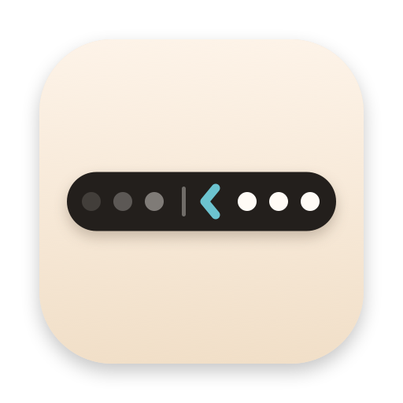

<p align="center">
  
</p>

<h1 align="center">Stow</h1>

<p align="center">
  <b>Daha sakin bir menü çubuğu, tek tık uzağında.</b><br>
  macOS için ücretsiz, açık kaynak bir menü çubuğu düzenleyicisi: nadiren kullandığın simgeleri kaldır,<br>
  tek tıkla, bir kısayolla ya da menü çubuğuna bir bakışla geri getir.
</p>

<p align="center">
  <a href="https://kaandis.github.io/stow/">Web sitesi</a> ·
  <a href="https://github.com/Kaandis/stow/releases/latest/download/Stow.zip">İndir</a> ·
  <a href="README.md">English</a>
</p>

## Ne yapar

- **Gizli ve Hep Gizli.** Stow menü çubuğuna bir ok ve ince bir ayraç ekler. Ayracın solundaki her şey kaldırılır; geri getirmek için oka tıkla. Hep Gizli’yi açarsan, simgeleri yalnızca oka ⌥ ile tıklayınca görünen ikinci bir ayraç gelir.
- **⌘ ile sürükleyerek seçersin.** ⌘’ye basılı tutup simgeleri ayracın öbür yanına sürükle; macOS menü çubuğunu zaten böyle düzenler. Sırayı macOS hatırlar.
- **Kendiliğinden geri kaldırır.** Gösterilen simgeler 5, 15, 30 saniye ya da bir dakika sonra yeniden gizlenir; ama işaretçi menü çubuğundayken ya da menülerinden biri açıkken asla.
- **Kısayol ya da üzerine gelmek.** ⌃⌥S veya ⌥⌘B ile aç-kapat, ya da işaretçi menü çubuğunda durunca simgeler görünsün.
- **Oka sağ tıkla:** Ayarlar, rehber ve Çık.
- **Harbor ile çalışır.** [Harbor](https://kaandis.github.io/harbor/) kuruluysa Stow’un ayarları orada görünür ve anında uygulanır.

## Neden böyle çalışıyor

- **Yalnızca herkese açık API.** Gizlemek, Stow’un kendi ayracını solundaki hiçbir şey sığmayana kadar genişletmektir. macOS o simgeleri çubuğun dışında bırakır. Ekran Kaydı yok, özel çerçeve yok; vermen gereken bir izin yok.
- **macOS 27’de isteğe bağlı tek izin.** Hep Gizli orada, uygulama menülerinin nerede bittiğini okuyup kendini o boşluğa göre boyutlandırmak için Erişilebilirliğe ihtiyaç duyar. Stow başka hiçbir şey okumaz.
- **macOS 27’de nasıl hareket eder.** Menü çubuğu her değişikliği kendisi canlandırır. Stow, boş öğeleri tam genişlikte ekleyerek gizler; simgeler yerinde soluklaşarak kaybolur. Gösterince soldan kayarak geri gelirler.
- **macOS 27’ye hazır.** macOS 27 menü çubuğunu tek parça çizer; bu, her simgenin penceresini taşıyan düzenleyicileri bozdu. Ayrıca simgelerin kenarına kendi taşma okunu ekler. Stow o pencerelere hiç dokunmadı; kaldırdığı simgeler o taşma menüsünde de bekler.
- **Ayrı çubuk yok.** Gizli simgeler için ikinci bir çubuk (Ice’taki gibi) her simgeye tek tek erişmeyi gerektirir; macOS 27 bunu artık sunmuyor. Stow sistemin desteklediği yolda kalır, güncellemelerle bozulmaz.
- **Sessiz.** Çubuk dururken hiçbir şey çalışmaz. Üzerine gelince gösterme varsayılan olarak kapalıdır, çünkü işaretçiyi izlemesi gereken tek özellik budur.
- **Her şeyi geri koyar.** Stow’dan çıkınca önce ayraç daraltılır; hiçbir simge itilmiş kalmaz.

## Kurulum

1. **[Stow.zip](https://github.com/Kaandis/stow/releases/latest/download/Stow.zip)**’i indir ve aç.
2. **Stow.app**’i Uygulamalar’a taşı ve aç.
3. İlk seferde Stow’a sağ tıklayıp **Aç**’ı seç (sürümler henüz notarize edilmedi) ya da şunu çalıştır:

```bash
xattr -dr com.apple.quarantine /Applications/Stow.app
```

Kısa bir rehber, simgeleri ayracın öbür yanına ⌘ ile nasıl sürükleyeceğini gösterir. Stow’un okunu ayracın sağında tut ki simgeler kaldırılınca görünür kalsın; değilse Stow söyler.

## Sorumluluk reddi

Stow bağımsız bir projedir; Apple Inc. ile bağlantılı değildir, Apple tarafından onaylanmamış veya desteklenmemiştir. Mac ve macOS, Apple Inc.’in ABD’de ve diğer ülkelerde tescilli ticari markalarıdır. Stow sıfırdan yazıldı; Ice, Hidden Bar ya da Bartender ile kod paylaşmaz.

## Lisans

[MIT](LICENSE)
